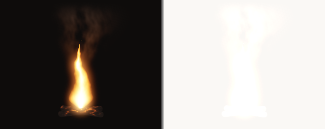
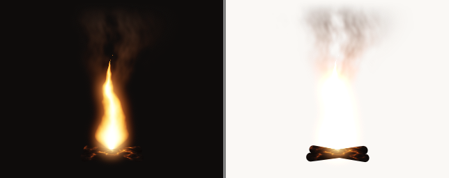
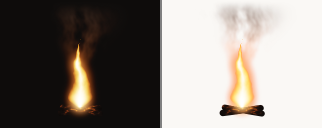
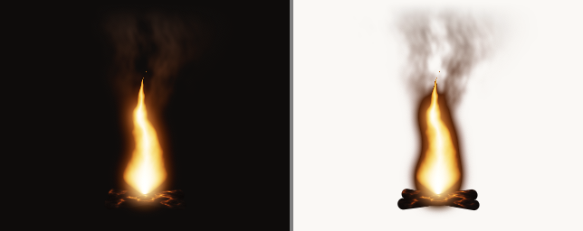
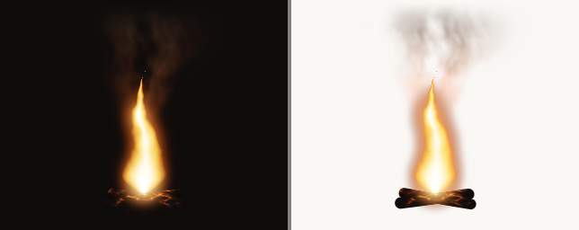
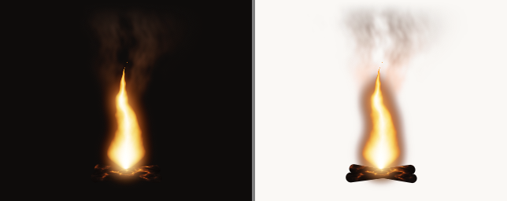
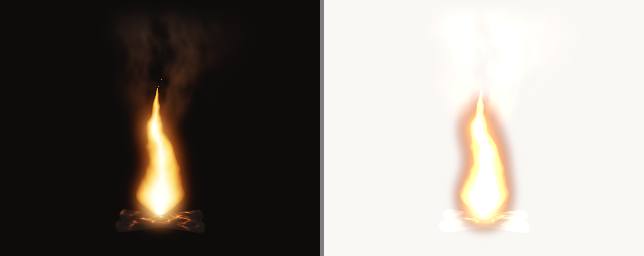
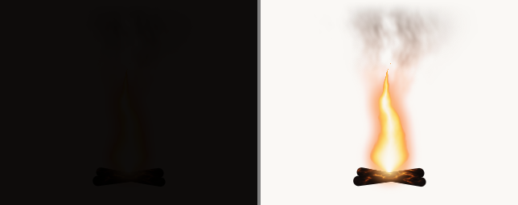
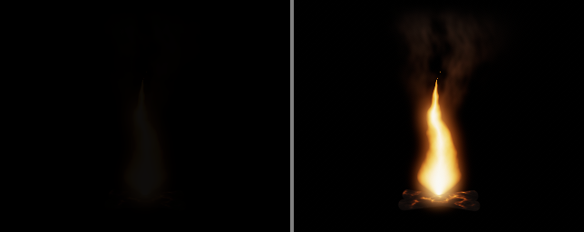

# Emissive compositing over the page

Story 3.3. An overlay fire effect draws into a transparent, premultiplied canvas that sits on top of
the page. What should it write so that it reads over **both** a dark page and a light one?

Short answer: a valid premultiplied colour whose alpha is the brightest channel of the colour
(`alpha: 'luminance'`, gain 1), plus a light underlay (`underlay: 0.3`). These are now the defaults
of `OVERLAY_PARAMS`. Pure additive output, and every CSS blend mode that only lightens, is invisible
on a light page by construction.

Everything here was rendered headlessly on Dawn and composited numerically
(`experiments/compositing.test.ts`). One browser has been looked at since (see
[Risks](#risks-to-verify-in-a-browser)); the CSS blend-mode rows are still only simulated from the
W3C formulas. The open points to verify in real browsers are listed under
[Risks](#risks-to-verify-in-a-browser).

Regenerate the images and tables with:

```
npx vitest run --silent=false --config experiments/vite.config.ts experiments/compositing.test.ts
```

## The one equation

The canvas is configured `alphaMode: 'premultiplied'`, so for each pixel the browser shows

```
result = rgb + (1 - alpha) * page        (in encoded sRGB, clamped to 0..1)
```

The output pass (`src/gpu/post/output.wgsl`) always writes the same `rgb`: the tonemapped,
sRGB-encoded scene plus bloom. A strategy is only a choice of `alpha`, that is, of how much of the
page to hide under the light.

- On a **dark** page, `page` is close to 0, so `alpha` barely matters. Every strategy gives almost
  the same picture.
- On a **light** page, `page` is close to 1 and so is the clamp. Adding light to it does nothing.
  The only way to show anything is to hide some page (`alpha > 0`), and then the fire is no longer
  light: it is a picture of fire, made of flame-coloured ink.

That second point is the whole problem. On a white page nothing can be brighter than the page, so
a flame can only differ from it in **hue** and by being **darker**. The strategies below differ in
how well they use those two.

## Test scene

Effect `compositing` (`src/effects/compositing/`): a flame that is emission only (scene alpha 0), a
smoke plume with real coverage (premultiplied soot, alpha up to 0.85), and two opaque charred logs.
It ends with the tail and spreads `OVERLAY_PARAMS`, with one preset per strategy. Flame body
radiance is about 8, the core about 24 (1.0 is paper white).

Pages: dark `#0e0c0b` and light `#faf8f5`, the `BACKDROPS` of `tests/headless.ts`. Each image
below shows the dark page on the left and the light page on the right, at 320 × 256.

## Strategies

| Strategy                                         | Canvas holds                                                       | Dark and light                                          |
| ------------------------------------------------ | ------------------------------------------------------------------ | ------------------------------------------------------- |
| Additive                                         | `alpha = 0`                                                        |                    |
| Coverage                                         | `alpha = scene alpha`                                              |                    |
| Luminance alpha, gain 1                          | `alpha = max(scene alpha, brightest channel)`                      |                  |
| Luminance alpha, gain 3                          | the same, times 3                                                  |               |
| **Luminance + underlay 0.3 (default)**           | luminance alpha, then the page dimmed by up to 30% around the glow |            |
| Luminance + underlay 0.6                         | the same, up to 60%                                                |            |
| Additive + underlay 0.6                          | `alpha` from the underlay only                                     |  |
| CSS `screen`, opaque canvas (simulated)          | `alpha = 1`, black background                                      |                    |
| CSS `plus-lighter`, luminance canvas (simulated) | luminance alpha                                                    |        |
| CSS `lighten`, opaque canvas (simulated)         | `alpha = 1`                                                        |                  |
| CSS `multiply`, luminance canvas (simulated)     | luminance alpha                                                    |                |
| CSS `multiply`, opaque canvas (simulated)        | `alpha = 1`                                                        |  |

What each one does:

- **Additive** adds the light to the page. Correct over dark. Over the light page the flame is
  gone: 5 to 10 steps of headroom are all `#faf8f5` has.
- **Coverage** passes the scene's alpha through. Smoke and logs appear on both pages. The flame has
  no coverage, so it stays additive: over the light page you get smoke rising from nothing.
- **Luminance alpha** hides the page in proportion to how bright the pixel is. Over dark it is
  additive to within the page's own brightness. Over light the flame keeps its colours, the bloom
  turns into a peach tint, and the white-hot core has the same brightness as the paper. Because it
  takes the larger of the scene alpha and the brightness, smoke and logs still cover.
- **Gain above 1** hides more page than there is light, which darkens every dim edge: a brown
  fringe. It gives the strongest contrast and looks sooty and hard. Useful as a look, wrong as a
  default.
- **Underlay** is a second, darker layer under the light. The bloom is its mask, widened so it
  reaches past the visible glow, and its strength is a ceiling on how much page it may hide. It
  multiplies with the mode's own alpha. Over dark it changes nothing you can see. Over light it
  dims the paper around the fire, so the core is again brighter than what surrounds it.
- **Additive + underlay** is the "dark smoke underlay" on its own. The page is dimmed but the flame
  is still only added, so it clips to paper white: a glowing stain without a flame body.
- **CSS `screen`, `plus-lighter`, `lighten`** can only make a pixel lighter. They match additive
  over dark and vanish over light. `plus-lighter` is exactly additive whatever alpha the canvas
  holds, which makes it the well-defined way to get an additive result (see Risks).
- **CSS `multiply`** can only make a pixel darker. With a luminance-alpha canvas it matches plain
  luminance alpha over light and vanishes over dark. With an opaque canvas it multiplies the page
  by the canvas's black background: a black box.

## Numbers

Regions are taken from the scene, not from any strategy: **core** is where the fire over black has
relative luminance above 0.7, **body** is the rest of the flame (above 0.12), **near** is the glow
just outside it, **smoke** is partly covered pixels with almost no light of their own.

- **Flame ΔE**: mean CIE76 colour difference (CIELAB, D65) between the composited flame (core and
  body) and the bare page. About 2.3 is a just-noticeable difference.
- **Body contrast**: WCAG contrast ratio of the body's mean luminance against the page.
- **Core / surround**: mean luminance of the core divided by the mean luminance of the glow around
  the flame. 1.0 means the core is no brighter than its surroundings.
- **Smoke ΔE**, **Glow ΔE**: as flame ΔE, for the smoke and for the glow.

| Strategy                                       | Page  | Flame ΔE | Body contrast | Core / surround | Smoke ΔE | Glow ΔE |
| ---------------------------------------------- | ----- | -------- | ------------- | --------------- | -------- | ------- |
| additive (alpha 0)                             | dark  | 93.7     | 9.68          | 14.60           | 13.5     | 43.0    |
| additive (alpha 0)                             | light | 2.9      | 1.06          | 1.00            | 2.8      | 2.7     |
| coverage (scene alpha)                         | dark  | 93.7     | 9.67          | 14.64           | 12.0     | 43.0    |
| coverage (scene alpha)                         | light | 3.1      | 1.06          | 1.00            | 21.8     | 3.6     |
| luminance alpha, gain 1                        | dark  | 91.1     | 8.64          | 15.55           | 12.0     | 41.9    |
| luminance alpha, gain 1                        | light | 37.4     | 1.48          | 1.38            | 21.8     | 28.8    |
| luminance alpha, gain 3                        | dark  | 90.8     | 8.48          | 18.77           | 11.6     | 40.0    |
| luminance alpha, gain 3                        | light | 41.7     | 2.17          | 10.20           | 29.4     | 72.0    |
| **luminance + underlay 0.3 (default)**         | dark  | 91.0     | 8.59          | 16.24           | 12.0     | 41.5    |
| **luminance + underlay 0.3 (default)**         | light | 38.4     | 1.66          | 1.95            | 21.9     | 36.3    |
| luminance + underlay 0.6                       | dark  | 90.9     | 8.54          | 16.98           | 12.0     | 41.0    |
| luminance + underlay 0.6                       | light | 39.6     | 1.85          | 2.94            | 22.0     | 45.9    |
| additive + underlay 0.6                        | dark  | 92.3     | 8.99          | 16.35           | 13.5     | 41.7    |
| additive + underlay 0.6                        | light | 18.9     | 1.08          | 1.76            | 3.0      | 31.5    |
| CSS screen, opaque canvas (simulated)          | dark  | 90.5     | 8.82          | 14.99           | 12.8     | 40.8    |
| CSS screen, opaque canvas (simulated)          | light | 2.1      | 1.04          | 1.05            | 0.3      | 0.7     |
| CSS plus-lighter, luminance canvas (simulated) | dark  | 93.7     | 9.68          | 14.59           | 13.6     | 43.0    |
| CSS plus-lighter, luminance canvas (simulated) | light | 2.9      | 1.06          | 1.00            | 2.8      | 2.7     |
| CSS lighten, opaque canvas (simulated)         | dark  | 90.8     | 8.48          | 19.15           | 8.3      | 39.2    |
| CSS lighten, opaque canvas (simulated)         | light | 0.6      | 1.00          | 1.01            | 0.0      | 0.0     |
| CSS multiply, luminance canvas (simulated)     | dark  | 1.3      | 1.01          | 1.14            | 0.9      | 1.0     |
| CSS multiply, luminance canvas (simulated)     | light | 37.8     | 1.55          | 1.31            | 22.0     | 28.7    |
| CSS multiply, opaque canvas (simulated)        | dark  | 1.4      | 1.03          | 4.67            | 3.2      | 2.8     |
| CSS multiply, opaque canvas (simulated)        | light | 42.2     | 2.28          | 18.92           | 91.3     | 82.3    |

Reading it:

- Over the **dark** page every strategy except `multiply` lands within a few percent of additive
  (flame ΔE 90.5 to 93.7). The choice costs nothing there.
- Over the **light** page, additive, `screen`, `plus-lighter` and `lighten` score a flame ΔE of 0.6
  to 2.9: at or below what the eye can see. Coverage shows the smoke (ΔE 21.8) and not the flame
  (3.1).
- Luminance alpha takes the flame over light from ΔE 2.9 to 37.4. The luminance contrast stays low
  (1.48): the flame is seen by its colour, not its brightness.
- The underlay is what moves core / surround: 1.38 without it, 1.95 at 0.3, 2.94 at 0.6. It does
  not change the dark page (16.24 against 15.55, both far above anything the light page can reach).
- The last row is the black box: high numbers, wrong picture.

How close is the default to additive over a dark page, per channel, in 8-bit steps:

| Compared with additive   | Page           | Max difference | Mean difference |
| ------------------------ | -------------- | -------------- | --------------- |
| luminance, gain 1        | black          | 2              | 0.14            |
| luminance, gain 1        | dark `#0e0c0b` | 16             | 0.96            |
| luminance + underlay 0.3 | black          | 2              | 0.15            |
| luminance + underlay 0.3 | dark `#0e0c0b` | 16             | 1.03            |

The differences over black are the dither. Over the dark page the largest difference is the page
itself (14 steps), hidden where the flame is at full brightness.

How much of each canvas is a colour brighter than its own alpha, which the canvas specification
leaves undefined (see Risks):

| Canvas content           | Drawn pixels | Brighter than alpha | Worst excess (8-bit) |
| ------------------------ | ------------ | ------------------- | -------------------- |
| additive                 | 23095        | 23095 (100%)        | 255                  |
| coverage                 | 25551        | 9339 (37%)          | 255                  |
| luminance, gain 1        | 25552        | 0                   | 0                    |
| luminance, gain 3        | 26412        | 0                   | 0                    |
| luminance + underlay 0.3 | 25885        | 0                   | 0                    |

### What carries the picture on a light page

The same canvases with the colour taken out of the light (every channel set to the brightest one),
over the light page:

| Neutral (white) light    | Flame ΔE | Core / surround | Glow ΔE |
| ------------------------ | -------- | --------------- | ------- |
| luminance, gain 1        | 2.7      | 1.04            | 1.1     |
| luminance + underlay 0.3 | 3.0      | 1.40            | 10.2    |
| luminance + underlay 0.6 | 4.5      | 1.96            | 21.6    |

White light over a white page is invisible under luminance alpha, exactly: `v + (1 - v) * 1 = 1`.
The underlay then draws a grey halo around something that is not there. **Hue is all a light page
leaves to see.** A saturated orange flame survives; white sparks, lightning-white cores and steam
do not.

The same flame at three brightnesses, default strategy, light page:

| Scene                      | Flame ΔE | Core / surround (without underlay) | Glow ΔE |
| -------------------------- | -------- | ---------------------------------- | ------- |
| embers only, intensity 1.5 | 49.8     | 1.58 (1.52)                        | 39.2    |
| default flame, intensity 8 | 38.4     | 1.95 (1.38)                        | 36.3    |
| white-hot, intensity 30    | 34.1     | 1.98 (1.48)                        | 37.0    |

Dim fire is not the problem: it is the most saturated, so it shows best. The hotter the flame, the
more of it is core, and the more of it is paper-coloured.

## Recommendation

**Default for every overlay effect: `alpha: 'luminance'`, `alphaGain: 1`, `underlay: 0.3`.**
Spread `OVERLAY_PARAMS` and change nothing. The reasons, in order:

1. It reads on both pages. Flame ΔE over light is 38.4, against 2.9 for additive.
2. It costs nothing on dark pages: at most 16 of 255 steps from additive, 1.0 on average.
3. It is always a valid premultiplied colour (no channel above alpha), so it does not depend on
   behaviour the canvas specification leaves undefined. Additive is invalid in every drawn pixel.
4. Coverage still works: the alpha is the larger of the scene's alpha and the brightness, so an
   effect that draws smoke or char with real coverage gets it for free.
5. The underlay at 0.3 lifts core / surround from 1.38 to 1.95 on the light page and cannot be seen
   on the dark one. At 0.6 the page looks scorched, which is a look to choose, not a default.

What an effect should do:

- Write linear radiance for light and leave scene alpha at 0 for it. Write premultiplied colour and
  real coverage in scene alpha for anything that blocks the page: smoke, char, silhouettes.
- Keep bloom on. The underlay uses it as its mask, and the glow is the only thing on a light page
  that says "this is light".
- Keep smoke dark. Its colour is encoded after it was premultiplied, so thin, pale smoke comes out
  lighter than the same colour drawn by CSS would.
- Raise `underlay` to 0.5 or more only when the core has to stay the brightest thing on the page.
- Use `alphaGain` above 1 for a sooty, hard-edged look, never below 1 for a default (the colour
  is brighter than its alpha again).
- Choose `additive` only for a page that is known to be dark, and then prefer a luminance canvas
  with `mix-blend-mode: plus-lighter`, which is the same picture from a valid canvas.

### When to mark an effect dark-theme-only

Fill in `scorecard.lightPage` from what the effect is made of, after looking at it over the light
page:

- **`yes`**: a saturated flame with a shape. Orange, red, copper green or sodium yellow bodies,
  burn fronts, ember beds, smoke, char. Measured here: flame ΔE 34 to 50 over the light page with
  the defaults.
- **`underlay`**: the effect only works if its hottest part looks brighter than its surroundings:
  cores, explosions, a furnace mouth. It needs `underlay` at 0.5 or more (core / surround 2.9 at
  0.6) or a dark backplate drawn by the page.
- **`no`**, and say so plainly, when any of these holds:
  - The light is close to white or has little hue: sparks, lightning, white-hot metal, steam glow.
    Measured: flame ΔE 2.7 to 4.5 over the light page, underlay or not.
  - The effect is its glow: firelight on the page, light cast on other elements, light shafts, a
    warm wash. A white page cannot be lit. What is left is a tint (glow ΔE 29 to 36): a stain,
    not light.
  - It depends on being brighter than paper white: anything built for the HDR canvas.
  - It is made of points too small to hold colour: a spark one pixel wide is an orange speck.

## Changes made

- `OVERLAY_PARAMS` (`src/gpu/post/tail.ts`): `alpha` defaults to `luminance` (was `additive`) and
  `underlay` to 0.3 (was 0).
- Underlay (`src/gpu/post/output.wgsl`). It used to be `alpha = max(alpha, underlay² × glow)`. That
  could never exceed the glow's own brightness, so in `luminance` mode it did nothing at all: the
  two renders were identical. It is now a second layer, `alpha = 1 - (1 - modeAlpha) * (1 - veil)`
  with `veil = underlay * (1 - (1 - glow)³)`: 0 when off, never above its setting, wider than the
  visible glow, and it adds to every mode.
- Luminance alpha is taken from the colour that is actually written, dither included, so the
  output is strictly valid at any gain of 1 or more (the dither could put a channel one step above
  alpha before).
- `tests/compositing.test.ts` covers the four modes and the underlay numerically.

`docs/effect-authoring.md` still describes `additive` first and the old underlay; its "Over the
page" section should be updated to match this page.

## Risks to verify in a browser

**One browser check so far (2026-10-13).** In the Claude desktop app's built-in Chromium pane, on
macOS, with the `compositing` effect over a light and a dark stage:

- The default (`luminance`, underlay 0.3) looks as the headless composite predicted, on both.
- `additive` (alpha 0 everywhere) showed **nothing at all**, over the dark stage as well as the
  light one. The headless arithmetic says it should be the brightest result over dark.

That was seen through the pane's screenshots, so it does not separate the page compositor from the
capture path; either way it is the undefined case of risk 1 turning out badly rather than well.
Safari, Firefox, Chrome proper and the CSS blend presets are still unchecked.

1. **Colour brighter than alpha.** `additive` writes `rgb > alpha` in every pixel, and `coverage`
   in every flame pixel. For a premultiplied WebGPU canvas shown on screen the specification says
   the result of compositing such values is undefined. Browsers that composite with the plain
   `rgb + (1 - alpha) * page` blend show the additive picture; a path that un-premultiplies first
   (colour conversion, a hardware overlay, some capture and screenshot paths) clamps or breaks.
   Check `additive` and `coverage` in Chrome, Safari and Firefox, on an HDR display too, and in a
   screenshot or `drawImage` of the canvas. The default does not have this risk.
2. **CSS blend modes are simulated.** Check `mix-blend-mode` on the canvas with the `css …` presets
   of the effect: that `plus-lighter` is supported and matches additive, that the blend sees the
   page behind the canvas (it only reaches as far as the canvas's stacking context), and what it
   costs: a blended element forces the browser to composite its backdrop first. Not measured.
3. **Blending space.** The numbers assume the browser composites in encoded sRGB. A page or browser
   that composites in linear light or in a wide-gamut space will move every figure a little.
4. **HDR canvas.** In extended range the colour can exceed 1 while alpha stops at 1. Not looked at.
5. **The underlay follows the bloom.** No bloom, no underlay, and its reach is the bloom's reach.
   The page colour is unknown to the canvas, so the same alpha has to serve both themes; that is
   why the default was chosen to be invisible on dark.

## References

- W3C, [Compositing and Blending Level 1](https://www.w3.org/TR/compositing-1/): source-over and
  the separable blend modes used for the simulated rows.
- W3C, [Compositing and Blending Level 2](https://drafts.fxtf.org/compositing-2/) (draft):
  `plus-lighter`.
- W3C, [WebGPU, `GPUCanvasAlphaMode`](https://www.w3.org/TR/webgpu/#enumdef-gpucanvasalphamode):
  what a premultiplied canvas promises, and what it does not.
- T. Porter, T. Duff, "Compositing Digital Images", SIGGRAPH 1984: premultiplied alpha and "plus".
- [backdrop-capture-study.md](../../watertemple/docs/backdrop-capture-study.md) (Water Temple):
  why the canvas cannot read the page it sits on.
